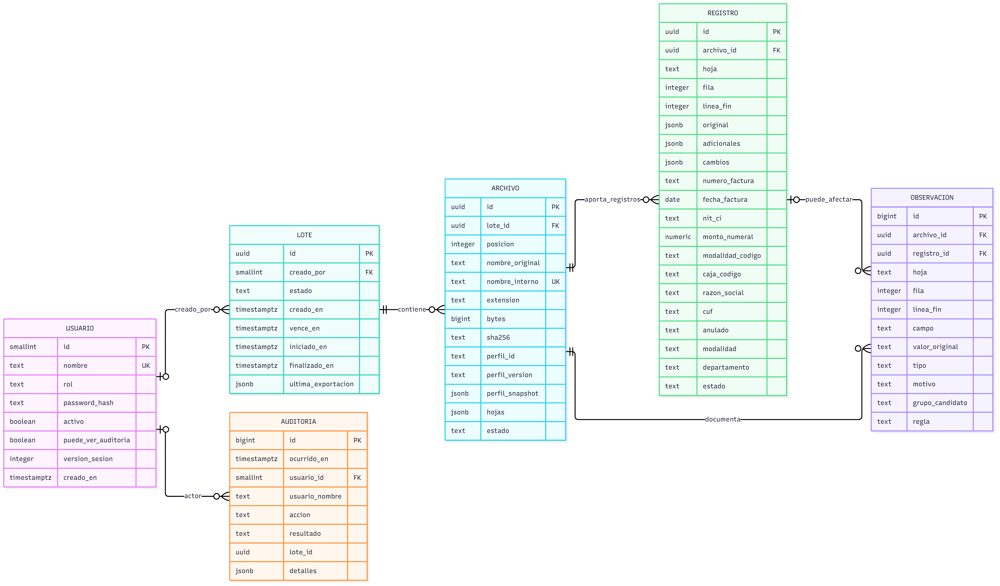

# DER vigente y caso de estudio

> **2026-11-24, usuarios y roles:** [Entrega vigente](USUARIOS_Y_ROLES.md). Cuentas administradas exclusivamente por Administrador; permisos por rol y consultas limitadas a cargas propias, con acceso general del administrador. Incluye recuperar cargas vigentes. Modelo actual: 6 tablas/69 atributos; usuario tiene 8 campos. Las referencias anteriores a cuenta unica, falta de roles o 68 atributos son antecedentes. Migracion 006 ya aplicada en la base local; reiniciar Flask y recompilar/reiniciar Next.js.


Actualizado el **2026-11-24**. Modelo implementado del prototipo de limpieza y comparación de facturas de Editorial Canelas S.A. — Los Tiempos. La solicitud de auditoría amplía el modelo a **6 entidades y 69 atributos**.



[SVG para ampliar](fase_1/diagramas/entidad_relacion.svg) · [Mermaid editable](fase_1/diagramas/entidad_relacion.mmd) · [Diccionario](fase_1/02_DATOS.md) · [DDL vigente](fase_1/schema_propuesto.sql).

## Entidades

| Entidad | Atributos | Propósito |
|---|---:|---|
| usuario | 8 | Cuenta, rol, hash de contraseña, estado, versión de sesión, permiso de auditoría y fecha de creación |
| lote | 8 | Carga, autor, estado, fechas y metadatos de última exportación |
| archivo | 13 | Archivo recibido, hash, perfil, hojas, posición y estado |
| registro | 20 | Fila original, normalización, cambios y campos de factura |
| observacion | 12 | Incidencias con tipo, motivo, regla y origen |
| auditoria | 8 | Fecha, actor, acción, resultado, referencia de lote y cantidades/códigos |

## Relaciones

| Relación | Regla |
|---|---|
| usuario → lote | Una cuenta puede crear muchos lotes; autor nullable solo para conservar lotes históricos. ON DELETE RESTRICT |
| lote → archivo | Un lote contiene cero o muchos archivos en SQL; el servicio exige al menos uno. Borrado en cascada |
| archivo → registro/observacion | Cada archivo puede aportar muchas filas e incidencias; borrado en cascada |
| registro → observacion | Una incidencia puede referirse a una fila o ser estructural sin registro; la FK compuesta asegura el mismo archivo |
| usuario → auditoria | Un actor tiene cero o muchos eventos; usuario nullable, ON DELETE SET NULL. Se conserva el nombre histórico |

`auditoria.lote_id` no es FK: permite conservar el historial después de purgar una carga. Por ese motivo no se dibuja una relación referencial con lote.

## Decisiones del caso de estudio

- La migración 006 retira la restricción de cuenta única y añade `usuario.rol`. Solo Administrador crea y modifica cuentas; los permisos efectivos se calculan por rol en Flask. El permiso adicional `puede_ver_auditoria` permite limitar el historial entre administradores.
- Cajas y Contabilidad cuentan con perfiles iniciales de permisos, junto con Solo lectura, Consulta y descarga y Solo carga. Son una configuración inicial del prototipo; no se presentan como política empresarial validada. Cada usuario consulta sus propias cargas; el administrador puede supervisar todas.
- `password_hash` guarda scrypt. La cookie firmada y HttpOnly contiene la sesión; `version_sesion` permite revocarla. No se almacena la contraseña en auditoría.
- La modalidad se deriva de la columna de contrato seleccionada (C/P). Departamento está fuera del flujo por decisión del responsable; sus campos se conservan para datos históricos. Migración 004 ajusta el CHECK de válido.
- Las facturas repetidas se conservan por archivo, hoja y fila; no hay unicidad global por factura, NIT o CUF. La comparación por factura y columnas elegidas no elimina ni fusiona registros y no crea una tabla de conciliación.
- `perfil_snapshot` conserva las reglas de lectura y selección de contrato. `ultima_exportacion` conserva la última generación limpia correcta; el Excel se genera en memoria.
- Auditoría persiste eventos de operaciones, accesos y resultados sin valores de clientes. Las normalizaciones por campo permanecen en registro durante la retención del lote. No hay borrado de eventos desde la aplicación ni reconstrucción del pasado.

[Alcance y pruebas de auditoría](AUDITORIA.md) · [Modalidad por contrato](MODALIDAD_CONTRATO.md) · [Exportaciones](EXPORTACIONES.md).

## Verificación y regeneración

Las seis entidades y sus 69 campos están representados en la fuente Mermaid y el DDL. Se ejecutaron las migraciones y 197 pruebas del backend con PostgreSQL aislado, incluidas auditoría y permisos. Los artefactos SVG/PNG se regeneraron con Mermaid CLI; el bloque del diccionario coincide con la fuente editable.

```powershell
mmdc -i docs/fase_1/diagramas/entidad_relacion.mmd -o docs/fase_1/diagramas/entidad_relacion.svg -b transparent
mmdc -i docs/fase_1/diagramas/entidad_relacion.mmd -o docs/fase_1/diagramas/entidad_relacion.png -b white --size 2400 -s 2
```
