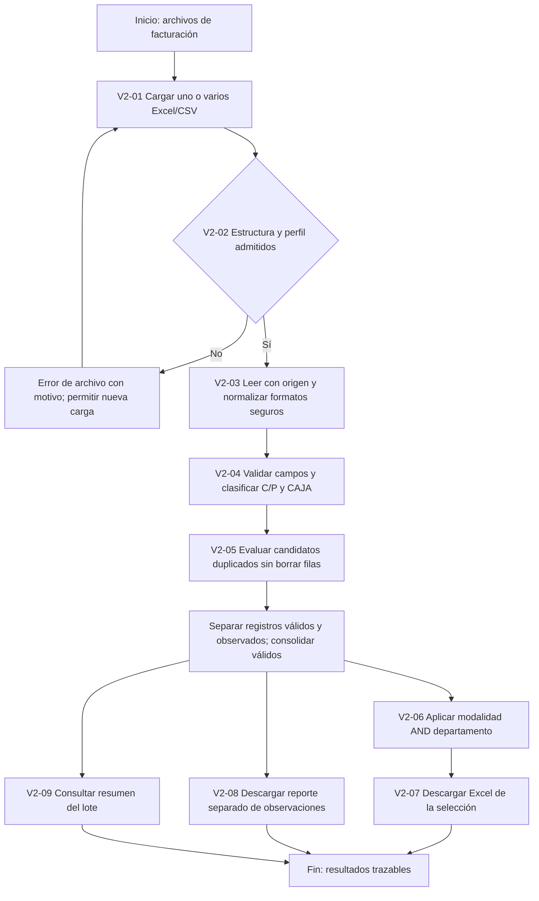

# Fase 0 — Revisión y alineación

Fecha: 2026-11-17. Estado: revisión documental terminada; propuestas y decisiones funcionales pendientes de validación. No acredita aprobación empresarial ni cumplimiento del software.

> Actualización del mismo día: el usuario confirmó la [línea base](LINEA_BASE_MVP.md) y autorizó iniciar solo [Fase 1](fase_1/README.md). El cuerpo conserva el análisis inicial como antecedente. Su inventario de rutas, obligatorios propuestos, granularidad abierta, actores y recomendación de no avanzar quedan actualizados por la línea base y [decisiones vigentes](DECISIONES_PENDIENTES.md). Diagramas con rutas corregidas verificados; los BPMN editables ya no se exigen. `docs/REQUISITOS.md` corresponde en disco a `docs/REQUSITOS.md`. El To-Be v2 vigente está en [el diseño actualizado](fase_1/01_DISENO.md#to-be-v2).

## 1. Objetivo y alcance vigente

Prototipo web para importar uno o varios Excel/CSV de facturación, reconocer sus columnas, limpiar formatos seguros, detectar problemas, clasificar por modalidad y departamento, consolidar registros válidos, aplicar filtros y descargar Excel y reporte separado de observaciones. Mostrar cantidades coherentes de cargados, válidos, observados y exportados.

Referencias: RF-01 a RF-12 y RNF-01 a RNF-06 de [REQUSITOS.md](REQUSITOS.md). El nombre del archivo existente tiene una errata; se conserva para no alterar las fuentes.

Clasificación definida documentalmente: `C o P`: C = Contado, P = Crédito. `CAJA`: C = Cochabamba, L = La Paz, S = Santa Cruz. El reconocimiento de códigos compuestos de caja requiere un catálogo confirmado.

Actores conceptuales: Cajas, Contabilidad y Sistemas. No implican permisos implementados. Stack indicado por PROMPT.md: Next.js/TypeScript, Flask, Pandas, PostgreSQL y Docker Compose. En esta fase no se implementan componentes, API ni esquema definitivo.

Fuera de alcance: conciliación Ventas–Contabilidad por NIT+fecha+monto, cierre contable validado, facturación electrónica, conexión al SAC, cambios a bases empresariales, conversión monetaria sin reglas aprobadas, edición manual de facturas y autenticación/RBAC completos.

## 2. Fuentes consultadas y ausencias

| Referencia solicitada en PROMPT.md | Fuente disponible y revisión | Resultado |
|---|---|---|
| PROMPT.md | Archivo raíz, leído completo | Ordena comenzar por Fase 0 y trabajar una fase por vez |
| docs/requisitos/REQUISITOS.md | docs/REQUSITOS.md, leído completo | Contiene 12 RF y 6 RNF |
| Word de requisitos en docs/requisitos/ | docs/Requisitos_RF_RNF_Data_Cleaning_Los_Tiempos.docx; texto de párrafos y tablas extraído del XML del DOCX | Las descripciones y prioridades RF y los RNF/criterios coinciden con Markdown; contraste automatizado exacto registrado al final |
| DCU.png y DCU.drawio en docs/diagramas/casos_uso/ | docs/DCU.png inspeccionado visualmente; docs/DCU.drawio leído como XML | Tres actores y funciones alineadas en términos generales con RF |
| 01_Situacion_Actual_As_Is.bpmn | Ausente; disponible docs/diagrama_as_is.png, inspeccionado visualmente | Antecedente de dos áreas con archivos aislados; no se verificó semántica BPMN editable |
| 02_Propuesta_Mejora_To_Be.bpmn | Ausente; disponible docs/diagrama_to_be.png, inspeccionado visualmente | Evidencia explícita de cruce histórico NIT+fecha+monto |
| docs/REGLAS_DE_NEGOCIO.md | Ausente | No se pueden atribuir reglas confirmadas a este documento |
| docs/DECISIONES_PENDIENTES.md | Ausente | Se crea un registro inicial separado, sin presumir decisiones previas |
| Reglas de validación adicionales | docs/reglas_de_validacion.md, leído completo | Mezcla validaciones aprovechables y conciliación histórica; no equivale a reglas empresariales confirmadas |

No se movieron ni editaron los documentos fuente. Las rutas abiertas en el IDE que no existen en disco no se consideran documentos consultados.

## 3. Hallazgos y contradicciones

Se aplica la prioridad de PROMPT.md: aclaraciones explícitas recientes, requisitos, reglas confirmadas, casos de uso, BPMN históricos y sugerencias técnicas.

| ID | Evidencia | Contradicción o falta de definición e impacto | Propuesta para To-Be v2 |
|---|---|---|---|
| H-01 | To-Be: «Carga de ambos documentos», Ventas y Contabilidad; RF-01/09 | Supone exactamente dos fuentes con roles fijos; el MVP admite varios archivos de facturación | Cargar 1..n archivos admitidos sin exigir pareja Ventas/Contabilidad |
| H-02 | To-Be: «Motor de Cruce de Datos», NIT+Fecha+Monto; reglas: «Correspondencia Ventas–Contabilidad» | Confunde consolidación estructural con conciliación y puede fusionar facturas distintas | Sustituir cruce por limpieza, clasificación y unión de registros válidos; ninguna llave de conciliación |
| H-03 | To-Be: «¿Hay coincidencia exacta de los datos duros?» y «Discrepancia detectada» | RF-08/11 requieren problemas de calidad, no diferencias entre dos contabilidades | Evaluar estructura, campos, clasificación y posibles duplicados; generar observaciones por origen |
| H-04 | To-Be: «Cierre contable validado» | Promete una validación contable fuera de los RF | Fin: archivos descargables y resumen de procesamiento; no certificar cierre |
| H-05 | As-Is: Ventas/Contabilidad; To-Be: Personal Administrativo/Contabilidad; DCU/PROMPT: tres actores | Responsabilidades actuales y propuestas no son equivalentes | Mantener As-Is como antecedente; To-Be v2 con Cajas, Contabilidad y Sistemas, sin simular permisos |
| H-06 | To-Be: ingesta/limpieza y reporte; RF-03 a RF-06/10/12 | No explicita C/P, CAJA, filtros combinados, Excel limpio ni contadores | Incorporar clasificación, filtros AND, dos salidas y resumen |
| H-07 | To-Be y reglas: eliminación de filas vacías; RF-08/11/12 | Descartar sin registro rompe observabilidad y reconciliación de cantidades | Propuesta: registrar fila vacía interior como observada y excluirla del consolidado; no contar el espacio vacío posterior al fin de datos |
| H-08 | Reglas: conservar duplicado válido según regla; PROMPT §§4–5 | No hay llave ni nivel cabecera/detalle definidos; descartar por factura repetida perdería productos | Mantener todas las filas; solo señalar candidatos según regla acordada, sin deduplicación destructiva |
| H-09 | Reglas: NIT solo numérico; RF-07: NIT/CI | Catálogo de documentos y posibles complementos de CI no documentados | Identificador textual; no aplicar una regla numérica universal a CI sin validación |
| H-10 | Reglas: moneda, tipo de documento, autorización y conversiones | Catálogos y obligatoriedad no están establecidos en RF ni muestras | Campos condicionales; conservar origen; conversión de moneda fuera de alcance hasta cambio autorizado |
| H-11 | Reglas: periodo contable; PROMPT: ejemplo con periodo; RF-05/06 | RF solo aprueban filtros de modalidad y departamento; no especifican control temporal | Fecha válida sí; rango y filtro por periodo como decisión pendiente, sin agregar exclusiones por defecto |
| H-12 | DCU.drawio: aristas AfYI5zyHW5fJS6qL779e-2/-3 sin atributo source | Las líneas hacia filtros/exportación parecen salir de Sistemas en PNG, pero no tienen actor de origen formal en XML | Reparar asociaciones en Fase 1 tras validar responsabilidades; no inferir permisos de las coordenadas |
| H-13 | DCU: caso «Ejecutar limpieza y consolidación» rotulado RF-07 a RF-09, incluye clasificación RF-03/04 | Rótulo omite cobertura de las funciones incluidas | Actualizar rótulo o especificación en Fase 1 para incluir RF-03/04 |

## 4. Matriz inicial RF ↔ casos de uso ↔ flujo ↔ módulos ↔ pruebas

Los CU y módulos siguientes son identificadores de análisis, no archivos implementados. Los pasos V2 son propuestas. En el BPMN histórico solo se acredita lo visible en las imágenes disponibles.

CU-01 Importar; CU-02 Ejecutar limpieza y consolidación; CU-03 Filtrar; CU-04 Consultar resumen; CU-05 Exportar Excel; CU-06 Descargar observaciones. Corresponden a los seis casos iniciados por usuarios del DCU.

| RF | Actor conceptual → CU / función interna | Imagen histórica → propuesta V2 | Módulo previsto | Prueba y criterio |
|---|---|---|---|---|
| RF-01 | Cajas, Contabilidad; Sistemas en soporte → CU-01 | Carga de ambos documentos → V2-01 carga 1..n | Lectura/importación | T01: Excel y CSV en un lote; cada fila conserva origen |
| RF-02 | Actores de CU-01 → validar estructura | Lectura de hojas → V2-02 validar perfil y columnas | Mapeo/estructura | T02: alias admitido mapea; falta o colisión de columna requerida produce error explícito |
| RF-03 | Contabilidad, Sistemas → CU-02 / clasificar | Ausente → V2-04 modalidad | Clasificación | T03: C/P correctos; X/vacío observado |
| RF-04 | Contabilidad, Sistemas → CU-02 / clasificar | Ausente → V2-04 departamento | Clasificación | T04: C/L/S correctos en perfil sintético; código no catalogado observado |
| RF-05 | Cajas, Contabilidad → CU-03 | Ausente → V2-06 filtro modalidad | Filtros | T05: Contado/Crédito/Todos seleccionan solo válidos correspondientes |
| RF-06 | Cajas, Contabilidad → CU-03 | Ausente → V2-06 filtro departamento AND modalidad | Filtros | T06: matriz 3 modalidades × 4 departamentos, intersección exacta |
| RF-07 | Contabilidad, Sistemas → CU-02 / normalizar | Ingesta/limpieza → V2-03 limpieza segura | Limpieza | T07: ceros iniciales, decimales exactos, texto y fechas; ambiguos conservados y observados |
| RF-08 | Contabilidad, Sistemas → CU-02 / detectar | Datos válidos/errores → V2-03/04/05 evaluación por fila | Validación/candidatos duplicados | T08: vacíos, faltantes, inválidos y candidatos trazables; no eliminar detalle legítimo |
| RF-09 | Contabilidad, Sistemas → CU-02 / consolidar | «Consolidado/Validado» por cruce → V2-05 unión estructural | Consolidación | T09: válidos de varios archivos con columnas uniformes y trazabilidad, sin cruce |
| RF-10 | Cajas, Contabilidad → CU-05 | Reporte final genérico → V2-07 Excel limpio | Exportación | T10: Excel reabierto contiene exactamente selección; identificadores textuales |
| RF-11 | Contabilidad, Sistemas → CU-06 | Reporte de discrepancias → V2-08 reporte de calidad separado | Observaciones/reportes | T11: cada error incluye tipo, motivo y archivo/hoja/fila; varias observaciones no duplican conteo de filas |
| RF-12 | Contabilidad, Sistemas → CU-04 | No explícito → V2-09 resumen | Resumen | T12: cantidades verificables con ecuaciones de §8, incluso cero resultados |

Sistemas está asociado formalmente a importación, procesamiento, resumen y observaciones en el XML. Su asociación a filtros/exportación requiere la reparación indicada en H-12. La matriz describe uso conceptual, no restricciones de acceso del MVP.

| RNF | Verificación prevista | Evidencia de aceptación requerida |
|---|---|---|
| RNF-01 | N01: hash SHA-256 de entradas antes/después | Hashes iguales; lectura y salidas en ubicaciones separadas |
| RNF-02 | N02: dos fuentes sintéticas de 1.000 registros; medir lectura a resultados/reportes listos | Menos de 30 s para lote de referencia como propuesta conservadora; registrar CPU, RAM, SO, versiones, tamaño, tres mediciones y máximo; acordar alcance exacto de «por fuente» |
| RNF-03 | N03: recorrido de usuario sin terminal | Cargar, procesar, elegir filtros y descargar en pantalla sencilla, mensajes comprensibles |
| RNF-04 | N04: extensión falsa, archivo corrupto, CSV inválido y estructura incompatible | Error controlado y posibilidad de reintentar; nunca éxito silencioso con lectura parcial |
| RNF-05 | N05: revisión de responsabilidades | Lectura, limpieza, clasificación, consolidación y reportes separables |
| RNF-06 | N06: revisión de repositorio, temporales y mensajes | Datos sintéticos; originales/reportes/secretos fuera del versionado; ubicación, acceso y eliminación de temporales documentados y comprobados |

No se han ejecutado T01–T12 ni N01–N06: son criterios futuros, no resultados.

## 5. Propuesta de flujo To-Be v2

Es una propuesta funcional, no un BPMN editable ni una validación empresarial. Carriles previstos: Cajas, Contabilidad, Sistema web y Sistemas (soporte); el sistema es participante técnico, no cuarto actor humano.

La exportación actualiza el contador de exportados para la selección descargada. Un error estructural no se convierte en filas inventadas: se reporta a nivel archivo. Política de continuar con otros archivos válidos del lote: pendiente P-09.

## 6. Diccionario propuesto de entrada y salida

Solo `C o P` y `CAJA` están confirmados como encabezados por los RF. Los demás nombres originales son candidatos para una plantilla sintética, no alias empresariales aprobados. No se dispone de archivo empresarial de ejemplo dentro de este proyecto.

Leyenda: E = entrada; S = salida; O = observación; «propuesto» no constituye obligatoriedad confirmada. Todo valor de ejemplo es ficticio.

| Original / origen | Canónico | Tipo lógico | Obligatorio | Regla propuesta o confirmada | Ejemplo ficticio | Manejo de error |
|---|---|---|---|---|---|---|
| Número de factura (candidato), E | numero_factura | Texto | Propuesto sí; P-02 | Recortar bordes, preservar ceros; patrón por perfil; nunca float | 000101 | Vacío/patrón desconocido: observar sin inventar |
| NIT/CI (candidato), E | documento_cliente | Texto | Propuesto sí; P-02/03 | Preservar ceros y contenido; validar según tipo/perfil aprobado | 00012345001 | No borrar símbolos internos sin regla; observar duda |
| Tipo de documento del cliente (candidato), E | tipo_documento_cliente | Texto de catálogo | Condicional, P-03 | Distinguir NIT de CI si la fuente lo informa | NIT | Catálogo pendiente; no inferir por longitud |
| Fecha (candidato), E | fecha_emision | Fecha ISO | Propuesto sí; P-02/05 | Formato explícito del perfil; fecha real; no adivinar día/mes | 2026-10-15 | Imposible/ambigua: observar; rango solo si acordado |
| Monto (candidato), E | importe | Decimal exacto | Propuesto sí; P-02/04 | 151.89, 333,60 y 2.680,00 según perfil inequívoco; ≥0 y ≤2 decimales son reglas heredadas pendientes | 2680.00 | Ambiguo, negativo o exceso de escala: observar según regla acordada; no redondear silenciosamente |
| Razón Social (candidato), E | razon_social | Texto | Pendiente P-02 | Recortar y colapsar espacios; conservar letras, puntuación y capitalización | Cliente Sintético Alfa | No inventar nombre ni usar como llave |
| C o P, E | modalidad_codigo | Texto | Sí para clasificación válida | C/P; recorte y mayúsculas solo como normalización documentada | C | Desconocido/vacío: observado; conservar original |
| Derivado de modalidad_codigo, S | modalidad | Enumeración | Sí en válidos | C→Contado; P→Crédito | Contado | Sin clasificación válida: nulo y observación |
| CAJA, E | caja_codigo | Texto | Sí para clasificación válida | Conservar código; catálogo/posición pendientes P-01; perfil sintético usa C/L/S exactos | C | Código no catalogado: observado; no buscar letras arbitrariamente |
| Derivado de caja_codigo, S | departamento | Enumeración | Sí en válidos | C→Cochabamba; L→La Paz; S→Santa Cruz con regla de caja validada | Cochabamba | Nulo y observación si no se reconoce |
| CUF (candidato), E | cuf | Texto | Condicional P-02/06 | Conservar; no asumir unicidad ni usar CUF ficticio como formato validado | CUF_SINTETICO_A | Falta/formato según perfil; no fabricar |
| Contrato (candidato), E | contrato | Texto | No, salvo perfil aprobado | Preservar ceros y código | 000042 | Conservar dato dudoso y observar si aplica |
| Moneda (candidato), E | moneda | Texto de catálogo | Condicional P-04 | Conservar; catálogo pendiente; sin conversión automática | BOB | Desconocida o mezcla: observar; no sumar monedas distintas |
| Nivel cabecera/detalle, E o perfil | nivel_registro | Enumeración | Necesario si existen ambos, P-06 | Definir granularidad por hoja/perfil; no inferir por número repetido | detalle | No consolidar/totalizar niveles ambiguos |
| Identificador de línea (candidato), E | identificador_detalle | Texto | Condicional P-06 | Distinguir líneas de producto si la fuente lo proporciona | 002 | No deduplicar por factura sola; revisión |
| Metadatos de carga, S/O | archivo_origen | Texto | Sí | Nombre seguro visible; identidad interna de importación evita colisiones entre nombres iguales | lote_a.csv | Rechazar rutas peligrosas; no exponer ruta local completa |
| Metadatos de lectura, S/O | hoja_origen | Texto o nulo | Sí en Excel; nulo CSV | Nombre de hoja real | Facturas | No omitir hoja de un Excel |
| Metadatos de lectura, S/O | fila_origen | Entero positivo | Sí | Excel: fila física 1-based; CSV: inicio de registro en línea física 1-based | 2 | Lectura sin origen fiable: no afirmar trazabilidad completa |
| Metadatos CSV multilínea, S/O | linea_fin_origen | Entero o nulo | Condicional | Fin físico del registro si ocupa varias líneas | 3 | Informar tramo y registro lógico; no confundir línea y registro |
| Metadatos de carga, S/O | importacion_id / registro_origen_id | Texto opaco | Sí | Identidad de lote/origen/fila, no llave empresarial de factura | lote_demo_01 / fila_demo_02 | Evitar colisiones entre cargas y archivos homónimos |
| Derivado, S/O | estado_validacion | Enumeración | Sí | Válido u observado a nivel fila; fallos de archivo van separados | observado | No usar «contablemente validado» |
| Diagnóstico, O | tipo_observacion / campo / motivo | Texto/catálogo | Sí; campo puede ser nulo | Una entrada por incidencia; nunca datos sensibles en logs técnicos | FORMATO / fecha_emision / fecha imposible | Siempre incluir referencia al origen |
| Copia contextual de entrada, O | valor_original / valor_normalizado | Texto o nulo | Según necesidad | Conservar dato original en reporte controlado; no en log público | 333,60 / 333.60 | No sobrescribir original al fallar; limitar acceso al reporte |
| Transformaciones, S/O | cambios_aplicados | Lista de campos/reglas | Cuando hubo corrección | Registrar regla y campo; preservar relación con origen | importe: decimal_coma | Corrección no explicable: observar y conservar |

Salida limpia: estructura común del perfil, clasificación, trazabilidad y transformaciones pertinentes. Salida de observaciones: registro de origen, campo, valor contextual, tipo y motivo; puede haber varias incidencias para una fila. No se fija todavía formato físico de persistencia ni tablas SQL.

Contrato de lectura propuesto para pruebas: CSV UTF-8 con/sin BOM, delimitador `;`, comillas dobles y encabezado en primera línea; fechas ISO y números con decimal explícito. Excel con hoja `Facturas`, encabezado fila 1 e identificadores almacenados como texto. Son perfiles sintéticos; los perfiles de producción y alias necesitan P-07. CSV con delimitador/codificación incompatibles debe producir error explícito, sin descartar registros por tolerancia silenciosa.

Si Excel ya almacenó un identificador como número y perdió ceros o precisión, no se puede reconstruir el original con certeza: conservar evidencia y observar; no rellenar ceros por suposición.

## 7. Muestra sintética y resultados esperados

Definición reproducible para futuros fixtures, no archivos empresariales ni pruebas ejecutadas. Perfil `sintetico_v1`: encabezados `Número de factura;NIT/CI;Fecha;Monto;Razón Social;C o P;CAJA`, cajas exactas C/L/S y fecha ISO. Obligatorios y formatos empresariales siguen pendientes. Periodo usado solo como contexto: octubre de 2026.

Base ficticia: factura `000101`, documento `00012345001`, fecha `2026-10-15`, monto `151.89`, razón `Cliente Sintético Alfa`, modalidad `C`, caja `C`. Cada variante usa número distinto salvo prueba explícita de repetición.

| Caso | Variante respecto de base | Expectativa propuesta | Cobertura |
|---|---|---|---|
| S01–S06 | Producto cartesiano C/P × C/L/S; facturas 000101–000106 | Seis válidos con las seis combinaciones; consulta Contado+Cochabamba retorna uno | T03/04/05/06 |
| S07 | Razón `  Cliente   Sintético Alfa  `; monto `333,60` | Espacios normalizados y decimal exacto 333.60; cambio registrado | T07 |
| S08 | Monto `2.680,00` | 2680.00 según perfil inequívoco; no 2.68 | T07 |
| S09 | Documento y factura con ceros iniciales en CSV y Excel-texto | Valores conservados carácter por carácter | T07/10 |
| S10 | Fecha `2026-02-30` | Observado por fecha imposible | T07/08/11 |
| S11 | Fecha `03/04/2026` sin perfil día/mes aprobado | Observado; no elegir marzo o abril | T07/11 |
| S12 | Monto `1,234` sin convención de miles aprobada | Observado por ambigüedad, sin conversión automática | T07/11 |
| S13 | Monto `-1.00` y `10.123` en variantes separadas | Observados bajo propuesta ≥0/máximo dos decimales; confirmar P-04 | T07/08 |
| S14 | Factura vacía, NIT vacío y monto vacío en variantes | Observados bajo propuesta de obligatorios P-02 | T08/11 |
| S15 | Fila enteramente vacía entre dos filas de datos | Observada y excluida del consolidado; conserva fila física | T08/12 |
| S16 | C o P `X` o vacío | Observado; modalidad nula | T03/08 |
| S17 | CAJA `Z`, `CL01` o vacío | Observado; no elegir primera letra sin catálogo | T04/08 |
| S18 | Repetir fila idéntica en otro archivo | Candidatos trazables; conservar ambas entradas; regla y elegibilidad pendientes P-06 | T08/09/11 |
| S19 | Misma factura/CUF en dos detalles distintos, líneas 001/002 | No tratar como duplicado por factura; no sumar importe de cabecera dos veces | T08/09 |
| S20 | Dos facturas distintas con NIT+fecha+monto iguales | No fusionar ni conciliar por esa coincidencia | T08/09 |
| S21 | Alias de encabezado aprobado en perfil; columna requerida ausente; dos columnas para un mismo canónico | Primer caso mapea; restantes errores de estructura explícitos | T02 |
| S22 | CSV con comillas sin cerrar o codificación incompatible | Error de archivo; recarga posible, sin éxito parcial silencioso | T01/N04 |
| S23 | Archivo renombrado .xlsx sin contenido Excel, archivo vacío y extensión no admitida | Errores controlados por archivo | T01/N04 |
| S24 | Dos archivos con mismo nombre; Excel con dos hojas; CSV con campo multilínea | Orígenes inequívocos por importación/archivo/hoja/fila o tramo; política de hojas pendiente | T01/09/11 |
| S25 | Filtro sin coincidencias y lote con todas las filas observadas | Resultado vacío explícito, resumen correcto y observaciones descargables; política de Excel vacío pendiente | T05/06/10/12 |
| S26 | Dos archivos de 1.000 filas válidas sintéticas | Medir rendimiento y hashes; no afirmar meta cumplida antes de ejecutar | N01/02 |

Fixture mínimo determinista para contadores: S01–S06 más tres filas distintas con fecha imposible, modalidad X y fila vacía interior. Esperado bajo la propuesta: cargados 9, válidos 6, observados 3; filtro Contado+Cochabamba seleccionados 1; antes de descargar exportados 0, después de una descarga exportados 1. Este fixture excluye duplicados y cabecera/detalle pendientes.

## 8. Criterios de aceptación y convenciones propuestas

1. Los 12 RF tienen caso de uso, módulo previsto y prueba en esta matriz; los seis RNF tienen una verificación identificada.
2. Ninguna normalización inventa información ambigua ni modifica archivos de entrada. La exportación conserva identificadores como texto; precisión de importes comprobada al reabrir, incluyendo 0.10, 333.60 y 2680.00.
3. Clasificación inválida produce observación, no departamento/modalidad por defecto. Filtros usan AND; «Todos» no restringe ese eje y no incorpora registros observados al consolidado limpio.
4. Propuesta de conteo por fila de entrada: `cargados = válidos + observados`. Una fila con varios errores cuenta una vez como observada; `cantidad_observaciones ≥ observados`. Contar filas interiores vacías observadas, no encabezados, pies reconocidos por perfil ni espacio vacío final. Todo descarte de contenido debe quedar explicado.
5. `seleccionados ≤ válidos`; tras descarga exitosa, `exportados = filas del Excel de esa selección`. Antes de descargar, exportados = 0. Repetir descargas no incrementa acumulativamente ese contador; un cambio de filtros reinicia el indicador de la selección actual. Esto es propuesta pendiente P-08.
6. Errores estructurales cuentan archivos rechazados por separado; no se conoce un conteo fiable de filas cargadas de archivos ilegibles. Mostrar alcance del resumen y archivos aceptados/rechazados.
7. Un consolidado no suma automáticamente importes ni colapsa líneas. No puede definirse total monetario por factura antes de resolver P-06; RF-12 pide cantidades de registros.
8. Reporte separado de observaciones como interpretación conservadora de RF-11; la alternativa de solo otra hoja sugerida en PROMPT.md se pospone hasta validación explícita. Cada incidencia referencia archivo/hoja/fila y motivo.
9. No se declara rendimiento, usabilidad, protección de datos ni aprobación empresarial sin pruebas/evidencia.

## 9. Plan propuesto de diez jornadas

Supone una persona desarrolladora disponible a jornada completa y respuesta del responsable a decisiones críticas al cierre de J2. Sin esas respuestas se limita la demostración a perfiles sintéticos y se registra la cobertura pendiente; no se prometen reglas de producción correctas por inferencia.

| Jornada | Etapa y entrega verificable | Condición de salida |
|---|---|---|
| J1 | Fase 0: inventario, contraste Word/Markdown, discrepancias, matriz y diccionario | Documentos de esta entrega revisables, fuentes intactas |
| J2 | Validar perfil y decisiones P-01 a P-08; Fase 1: arquitectura mínima, CU/actores, secuencias, modelo/DDL mínimo, API, wireframes y carpetas | Reglas sensibles resueltas o límite sintético explícito; trazabilidad sin ampliación de alcance |
| J3 | Fase 2.1: Compose, PostgreSQL, API Flask y Next.js con salud | Inicio reproducible y comprobaciones de conectividad |
| J4 | Importación, perfiles Excel/CSV, encabezados y origen | T01/02 y archivos inválidos básicos |
| J5 | Normalización exacta, validaciones y observaciones | T07/08 con campos y errores trazables |
| J6 | Clasificación, política acordada de candidatos y consolidación | T03/04/09, protección de detalle y originales |
| J7 | Interfaz de carga/resultados y filtros AND | T05/06, recorrido inicial N03 |
| J8 | Excel limpio, reporte separado y resumen | T10/11/12; relectura de salidas y contadores |
| J9 | Fase 3: regresión de RF, rendimiento, manejo de archivos y temporales | Matriz caso→resultado real; N01–N06 y correcciones prioritarias |
| J10 | Repetir solo verificaciones afectadas, documentación local Docker y demostración | Evidencias reproducibles, limitaciones y decisiones abiertas visibles |

El plan reserva dos jornadas para verificación/cierre, pero no incluye despliegue empresarial ni funciones adicionales. La Fase 1 aún no ha comenzado.

## 10. Confirmado, provisional y pendiente

**Confirmado por documentos consultados:** 12 RF/6 RNF; formatos .xlsx/.csv; C/P; correspondencia departamental C/L/S; filtros de modalidad/departamento; consolidación de válidos; Excel y reporte de problemas; resumen; originales intactos; stack y exclusiones establecidos por PROMPT.md. Esto describe la base documental, no una aprobación empresarial verificada de los diagramas.

**Provisional de esta revisión:** nombres canónicos y alias candidatos; seis CU numerados para trazabilidad; flujo V2; perfil sintético; conteo disjunto de filas; candidato duplicado como caso a revisar sin eliminación; reporte en archivo separado; benchmark de lote completo; plan de diez jornadas.

**Decisiones materiales pendientes:** catálogo y posición de CAJA; estructura real y obligatorios; NIT/CI; formatos de fecha/moneda; cabecera/detalle e importes; duplicidad; perfiles CSV/Excel; semántica de contadores. Se detallan en [DECISIONES_PENDIENTES.md](DECISIONES_PENDIENTES.md), sin convertirlas en reglas confirmadas.

Próximo paso recomendado: resolver las decisiones que afectan resultados con una descripción del formato o muestra anonimizada y el responsable funcional; después realizar Fase 1. No se necesita aprobación adicional para entregar este análisis, pero no corresponde cerrar reglas sensibles por suposición.

## 11. Verificación de esta entrega

- Se leyeron PROMPT.md, requisitos Markdown, Word, reglas de validación, XML draw.io y tres imágenes disponibles.
- Verificación automatizada ejecutada: las 18 filas RF/RNF del Word coinciden exactamente con Markdown, incluyendo descripciones, prioridades y criterios. Las 18 referencias aparecen en las matrices; enlaces locales y estructura de tablas comprobados.
- No se ejecutaron pruebas de producto ni de rendimiento: no existe implementación en esta entrega.
- Cambios limitados a este informe y al registro inicial de decisiones. Requisitos, reglas históricas y diagramas permanecen sin cambios.
