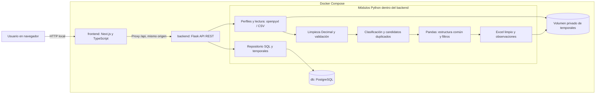
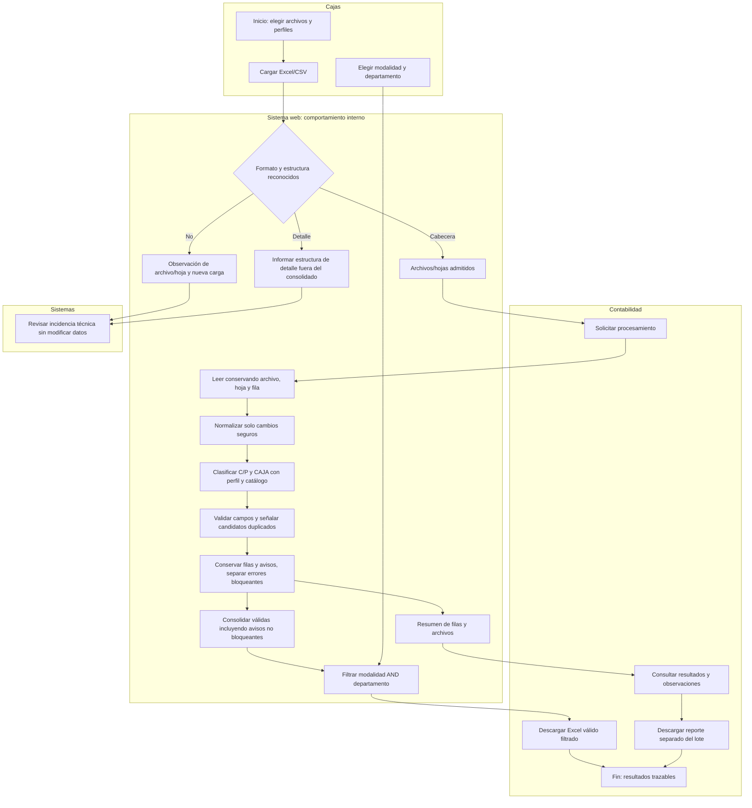
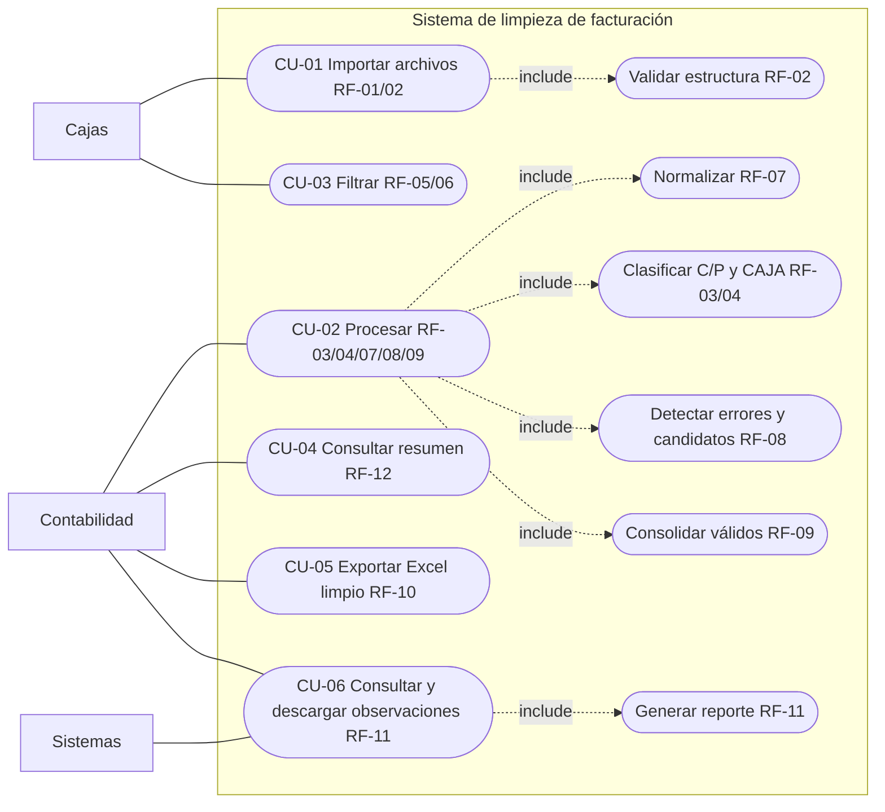
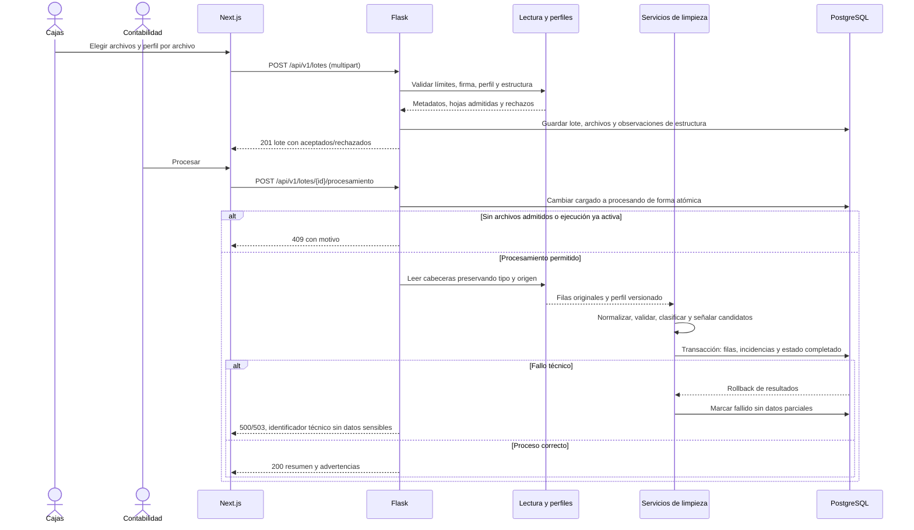
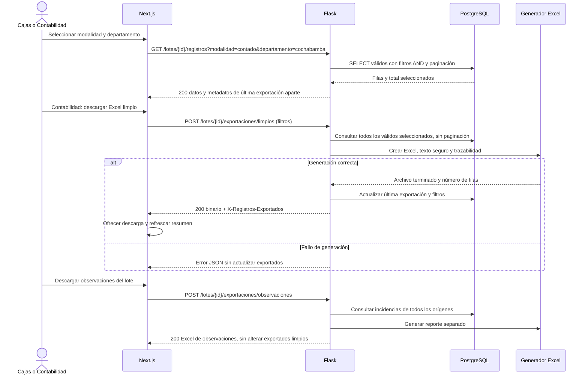
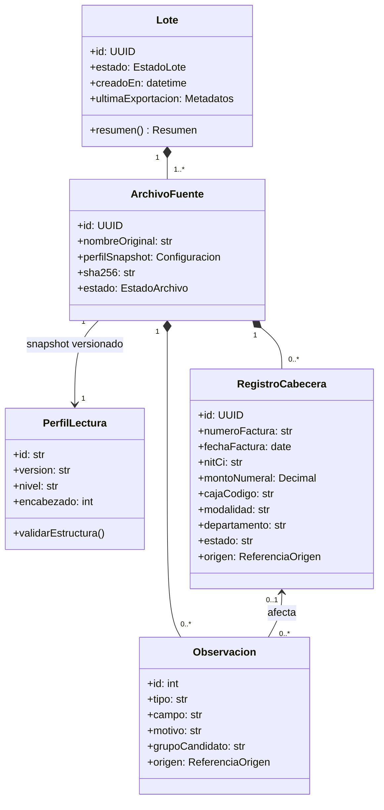

# Diseño funcional y arquitectura

## Base y decisiones

[Línea base del usuario](../LINEA_BASE_MVP.md), [RF/RNF](../REQUSITOS.md) y [decisiones con estado](../DECISIONES_PENDIENTES.md). Cada fila admitida es una cabecera de factura; las estructuras de detalle se reconocen y reportan aparte, sin consolidarlas. No se depende del nombre del archivo ni del color Excel. CUF/ANULADO se conservan sin inferir anulaciones o validez tributaria.

## Arquitectura de componentes



- Next.js muestra carga, selección de perfil, incidencias por archivo, resultados, filtros y descargas. Un cliente HTTP tipado concentra peticiones. El proxy reenvía cuerpo/errores/cabeceras de descarga sin cargar datos sensibles en logs ni convertir binarios en JSON.
- Flask separa rutas, validación de peticiones, orquestación y repositorio. Un proceso síncrono sirve la ejecución de hasta aproximadamente 2.000 filas objetivo; no significa rendimiento probado. Timeouts de proxy/backend se fijarán por encima del benchmark local, inicialmente 60 s. No hay tareas distribuidas.
- openpyxl lee Excel y escribe reportes. Lectura de identificadores con tipo de celda y formato de origen; no convertir a float mediante inferencia de Pandas. CSV se lee como texto con seguimiento de líneas físicas (incluidos campos multilínea). La biblioteca estándar `csv` evita perder ese origen.
- Decimal valida y normaliza montos antes de crear estructuras Pandas. Mantener objetos Decimal o representación textual; no usar float para importes ni identificadores. Pandas alinea columnas y consolida filas sin agregarlas ni eliminar duplicados.
- PostgreSQL conserva estado, metadatos de archivos, filas y observaciones por lote. El resultado de un lote completado es inmutable salvo metadatos de última exportación. Cada nueva carga crea otro lote.
- Tres servicios Compose: solo frontend expuesto en `127.0.0.1`; backend y DB en red privada. PostgreSQL usa volumen propio; backend un volumen privado de temporales. Credenciales por entorno, `.env.example` sin secretos reales; `.env`, temporales y reportes ignorados por Git. Dependencia de salud DB→backend→frontend; `/api/v1/health` comprueba API/DB sin datos administrativos.

Flask, Pandas y openpyxl son las bibliotecas previstas por PROMPT.md. Para PostgreSQL se propone únicamente un adaptador `psycopg`, con SQL parametrizado y transacciones, sin ORM adicional. Se justificarán/fijarán versiones al implementar; no se instalan dependencias en esta fase.

## To-Be v2

La siguiente propuesta sustituye el cruce histórico, sin editar [As-Is](../diagrama_as_is.png) ni [To-Be histórico](../diagrama_to_be.png). La vista Mermaid siguiente se conserva para discusión; el modelo formal BPMN 2.0 está en [to_be_v2.bpmn](diagramas/to_be_v2.bpmn). Validación y alcance en [correcciones](05_CORRECCIONES_CRITICAS.md). Las responsabilidades se toman de la instrucción reciente, no de la posición de las líneas del DCU antiguo.



El paso L se ejecuta únicamente al solicitar EJ; AC conserva la carga para procesar. Error o detalle en una hoja no habilita su incorporación como cabecera. Para libros mixtos, procesar solo hojas explícitamente reconocidas como cabecera y reportar cada hoja excluida. Archivo sin cabecera reconocida: rechazado. No extraer relaciones ni totalizar productos.

## Casos de uso actualizados

Los nombres y numeración CU-01..CU-06 mantienen la trazabilidad inicial. Se usa una vista Mermaid con elipses y relaciones rotuladas; no se pretende sintaxis UML ejecutable. La clasificación/limpieza son funciones internas, sin actor humano nuevo.



Sistemas consulta incidencias y verifica salud técnica, sin asignarle un flujo administrativo de exportación limpia. Todos los endpoints siguen accesibles en el prototipo local: estas asociaciones no implementan autorización. No se añade una pantalla ficticia de login.

| CU | Actor principal y precondición | Flujo/poscondición | Alternativas y RF |
|---|---|---|---|
| CU-01 | Cajas; perfiles disponibles | Elegir archivos/perfil por archivo; validar límites, estructura y hojas; crear lote con fuentes admitidas/rechazadas | Desconocido/corrupto: motivo por origen y recarga. RF-01/02 |
| CU-02 | Contabilidad; lote cargado con cabeceras admitidas | Procesar, normalizar, clasificar, validar, evaluar candidatos; guardar filas y observaciones atómicamente; resumen listo | Sin admitidos: 409; fallo técnico: rollback de resultados y lote fallido; sin resultados parciales ocultos. RF-03/04/07/08/09 |
| CU-03 | Cajas; lote completado | Elegir filtros AND y consultar selección paginada de válidos; no modifica lote ni clasificaciones | Cero coincidencias es resultado válido. RF-05/06 |
| CU-04 | Contabilidad; lote visible | Revisar cantidades de filas/archivos y última exportación con sus filtros | Procesamiento no completado: contadores de resultados nulos, no cero ficticio. RF-12 |
| CU-05 | Contabilidad; lote completado | Generar Excel de válidos seleccionados, reusar origen y columnas relevantes; registrar cantidad/filtros tras generación correcta | Selección vacía: encabezados y cero filas; fallo de generación no actualiza exportados. RF-10/12 |
| CU-06 | Contabilidad; Sistemas en soporte | Ver incidencias de lote y descargar reporte separado con referencias de origen | Incidencia de archivo puede no tener fila/campo; explicar motivo. Varias incidencias de una fila no multiplican observados. RF-11 |

## Perfiles y reglas de transformación

Un perfil versionado declara `id`, `version`, `nivel` (cabecera/detalle), extensiones, reglas de hoja, fila de encabezado (1 o 4), alias por campo, obligatorios, encoding/delimitador CSV, formato numérico, fechas, patrón/lista de CAJA y validadores de identificadores/CUF si están confirmados. No detectar formatos por nombre de archivo ni por color. La selección explícita de perfil elimina adivinación; un perfil incompatible informa error. Se guarda una copia de configuración por archivo para reproducibilidad.

Ejemplo conceptual, solo sintético:

```json
{
  "id": "demo_cabecera_xlsx_f4",
  "version": "1",
  "nivel": "cabecera",
  "extension": ".xlsx",
  "hojas": ["Facturas"],
  "fila_encabezado": 4,
  "obligatorios": ["numero_factura", "fecha_factura", "nit_ci", "modalidad_codigo", "caja_codigo", "monto_numeral"],
  "caja_patron": "^(?P<numero>[0-9]+)(?P<departamento>[CLS])$",
  "cajas_admitidas": ["0C", "1C", "1L", "1S"],
  "formatos_fecha": ["%Y-%m-%d"],
  "formatos_numero": ["decimal_punto", "decimal_coma", "miles_punto_decimal_coma"],
  "cuf_validador": null
}
```

Cada parser numérico debe devolver una interpretación inequívoca, sin inferencia general. `151.89`, `333,60` y `2.680,00` pueden convertirse exactamente según formatos declarados; `1,234` ambiguo se observa. Un CSV con coma decimal y delimitador coma exige comillas correctas o un perfil diferente; nunca separar a ciegas. Los alias solo mapean encabezados explícitos; colisiones y obligatorios ausentes son errores de estructura.

Los encabezados NRO FACTURA, FCH. FACTURA, NIT/CI y MONTO NUMERAL están citados por el informe; hoja/fila del formato principal siguen sin muestra validada. Perfiles y diccionario en [C-01/C-04](05_CORRECCIONES_CRITICAS.md). El ejemplo demo anterior es histórico y no habilita datos reales. Fila 4 es una variante de perfil, no autorización para omitir tres filas de cualquier archivo.

| Campo canónico | Tipo | Obligación confirmada | Regla / error |
|---|---|---|---|
| numero_factura | Texto | Sí | Preservar ceros; faltante observado, patrón por perfil |
| fecha_factura | Fecha ISO | Sí | Fecha real según formato explícito; imposible/ambigua observada |
| nit_ci | Texto | Sí | Recortar extremos; no borrar complementos; patrón por tipo pendiente |
| modalidad_codigo / modalidad | Texto / catálogo | Sí | C/P; derivar Contado/Crédito; desconocido observado |
| caja_codigo / departamento | Texto / catálogo | Sí | Código completo más patrón y catálogo; letra final C/L/S; no basta coincidencia regex |
| monto_numeral | Decimal | Sí | Exacto; límites/moneda según P-04; inválido observado, sin redondear |
| razon_social | Texto | No | Normalizar espacios sin cambiar letras/capitalización |
| cuf | Texto | Pendiente; conservar si existe | No inventar validación tributaria; uso como candidato solo con validador explícito |
| anulado | Texto original | Pendiente; conservar si existe | Sin filtro, reclasificación ni inferencia por color; dato no interpretado, advertencia de lote |
| archivo/hoja/fila y línea final CSV | Metadatos | Sí donde corresponda | Identificar origen aun con archivos homónimos; filas físicas base 1 |

Se conservan valores originales y columnas adicionales relevantes como texto/valores serializados exactos. No mezclar facturas con detalles ni sumar montos. Encabezados adicionales se exportan con prefijo `origen__` para evitar colisiones con campos canónicos y metadatos.

### Duplicidad corregida: C-03 / P-06

La regla anterior de excluir todas las ocurrencias por una clave candidata queda retirada. Se distingue repetición exacta de datos de sospecha de identidad; ambas conservan las filas. Una coincidencia sin contexto suficiente nunca justifica retirar una factura legítima.

La política provisional conserva cabeceras con avisos no bloqueantes en el Excel válido si pasan las demás validaciones; registra tipo/regla/grupo en observacion y muestra el aviso también en la salida. Los errores independientes siguen siendo bloqueantes. No se añade tabla ni endpoint. Definición precisa y casos de numeración reutilizada, CUF distintos y detalle en [correcciones C-03](05_CORRECCIONES_CRITICAS.md).

## Secuencia de importación y procesamiento



Lote completado: repetir POST devuelve el mismo resumen, sin volver a insertar filas. Procesando: 409. Fallido: nueva carga en lugar de repetir sobre estado incierto. Al reiniciar, ejecuciones interrumpidas se marcan fallidas. La transacción de resultados no permanece abierta durante la subida ni durante lectura de archivos.

## Secuencia de filtros y exportaciones



Resumen: `cargados = válidos + observados` entre cabeceras leídas; `seleccionados ≤ válidos`; incidencias de archivos/hojas se cuentan aparte. `exportados` es la última generación limpia exitosa y se muestra con sus filtros/fecha; no se acumula ni cambia al filtrar. No se puede certificar recepción efectiva del navegador por emitir una respuesta HTTP.

## Modelo de dominio



PerfilLectura es configuración, no tabla adicional. Los servicios se representan en componentes/secuencias; no se convierte cada módulo en clase. ReferenciaOrigen es un valor compuesto de archivo/hoja/fila/línea final, no otra entidad persistida.

## Archivos y límites operativos propuestos

P-12: archivos con nombre interno UUID, originales solo en almacenamiento privado de backend; no usar rutas proporcionadas por cliente. Verificar extensión y contenido, tamaños comprimido/descomprimido, número de archivos/hojas/filas/celdas y rechazar fórmulas en campos obligatorios sin ejecutar macros ni enlaces. XLSX con fórmula sin valor fiable se observa; no evaluar fórmulas. No convertir automáticamente fechas seriales de CSV en fechas Excel.

La escritura Excel fuerza tipo texto para identificadores y textos que comiencen con `=`, `+`, `-` o `@`, evitando interpretación como fórmula sin alterar el valor lógico. Importes válidos se escriben como números tras comprobar precisión; si no se puede garantizar una representación numérica fiel dentro del rango admitido, escribir decimal como texto etiquetado o rechazar esa conversión de salida explícitamente. Nunca usar `float()` indiscriminadamente.

Retención provisional 24 h, mismo vencimiento para lote, entradas y resultados. Limpieza al arrancar y barrido periódico en el proceso backend (sin servicio adicional); no borrar lotes en procesamiento o exportación. Al expirar, marcar vencido, bloquear acceso con 410, borrar archivos y luego filas en transacción con cascadas; reintentar si falla y no ocultar residuos en disco. Los lotes vencidos ya eliminados devuelven 404. Credenciales/valores administrativos no aparecen en logs; reporte de observaciones sí contiene datos de revisión bajo acceso local controlado.

Este diseño no satisface por sí solo RNF-06 para acceso remoto/multiusuario: el MVP sin autenticación se limita a equipo/red local controlados. No se agrega despliegue empresarial en esta fase.
