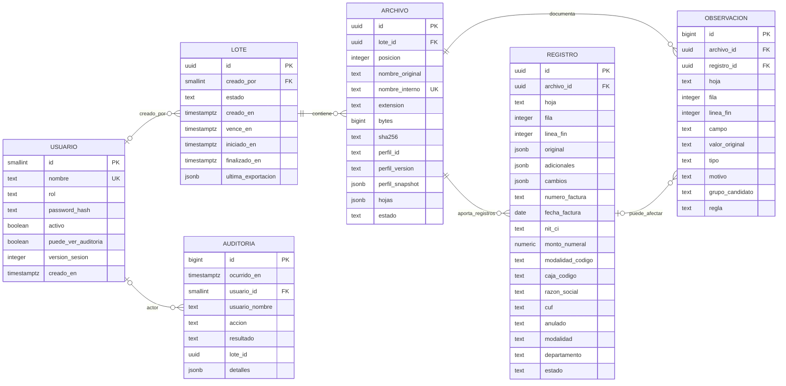

# Persistencia mínima y diccionario

## Ampliación vigente: usuarios y roles

La migración 006 añade `usuario.rol` (TEXT NOT NULL, default `consulta`, CHECK de seis perfiles), retira los CHECK de id=1/nombre=admin y añade una secuencia SMALLINT de IDs y un índice único de nombre normalizado. Hay **6 entidades/69 atributos**; usuario tiene 8. El rol y el permiso adicional de auditoría determinan las capacidades efectivas. `lote.creado_por` filtra la consulta propia; el administrador conserva consulta general. No se añaden tablas de áreas empresariales ni se modifica registro/observacion. [Matriz y API vigentes](../USUARIOS_Y_ROLES.md).

> **2026-11-24, usuarios y roles:** [Entrega vigente](../USUARIOS_Y_ROLES.md). Cuentas administradas exclusivamente por Administrador; permisos por rol y consultas limitadas a cargas propias, con acceso general del administrador. Incluye recuperar cargas vigentes. Modelo actual: 6 tablas/69 atributos; usuario tiene 8 campos. Las referencias anteriores a cuenta unica, falta de roles o 68 atributos son antecedentes. Migracion 006 ya aplicada en la base local; reiniciar Flask y recompilar/reiniciar Next.js.

> **Cambio de validación 2026-11-23:** [modalidad por contrato y departamento fuera de alcance](../MODALIDAD_CONTRATO.md). Cinco tablas y 59 campos sin cambios; migración 004 sustituye el CHECK de válido para no exigir caja/departamento. La columna de contrato y departamento_activo=false se conservan en archivo.perfil_snapshot; modalidad_codigo se deriva como C/P con trazabilidad. Los lotes previos conservan sus valores y observaciones. Las exigencias departamentales siguientes describen el diseño anterior.

> **DER vigente — 2026-11-19:** cinco entidades y todos sus campos, incluidas la cuenta única `usuario` y la FK nullable `lote.creado_por`. Los lotes históricos conservan autor NULL. El modelo corresponde al DDL inicial y a la migración 003 del login; esta revisión documental no cambia la base. [Explicación para el caso de estudio](../DER_ACTUAL.md) · [SVG](diagramas/entidad_relacion.svg) · [PNG](diagramas/entidad_relacion.png) · [fuente editable](diagramas/entidad_relacion.mmd).

> Ajuste concreto por formatos reales: extensión .xls admitida mediante migración 002 y CHECK actualizado, sin nuevas tablas. El nivel cabecera/detalle se deriva de perfil_snapshot; las relaciones se calculan sin modificar datos. [Revisión de material](../FORMATOS_MATERIAL.md).

El diseño inicial de cuatro tablas se ejecutó en Fase 2.1 en una instancia aislada de PostgreSQL 17; resultados históricos en [Fase 2.1](../fase_2_1/README.md). Línea base: RF-01/08/09/11/12 y RNF-01/06. La ampliación actual añade usuario como quinta entidad; no hay tablas de permisos, clientes maestros, productos, conciliación ni catálogo empresarial inventado.

## Entidad-relación

El diagrama representa cardinalidades permitidas por SQL. Un usuario puede crear cero o muchos lotes; un lote tiene cero o un usuario por compatibilidad con los históricos, pero la API asigna el administrador autenticado a cada carga nueva. SQL admite un lote sin archivos; el servicio exige al menos uno al crearlo. Un archivo puede carecer de registros por rechazo o no contener filas; un detalle admitido sí conserva sus registros. Una observación puede afectar un registro o solamente archivo/hoja. La FK compuesta exige que registro y observación pertenezcan al mismo archivo.

## Diccionario de tablas

Tipos completos y restricciones en [schema_propuesto.sql](schema_propuesto.sql). UUID se genera en aplicación con biblioteca estándar, sin extensión PostgreSQL adicional. BIGINT identity solo para identificador técnico de observación, nunca identificador de factura.

| Tabla/campos | Tipo y nulos | Uso y regla |
|---|---|---|
| usuario.id | SMALLINT, no nulo, PK, CHECK id=1 | Una sola cuenta en la demostración; el modelo desplegado no admite altas de otras cuentas |
| usuario.nombre | TEXT, no nulo, UNIQUE, CHECK nombre='admin' | Nombre de inicio de sesión; no es nombre de cliente ni rol empresarial |
| usuario.password_hash | TEXT, no nulo | Hash scrypt generado por Werkzeug; no guardar contraseña en texto plano |
| usuario.activo | BOOLEAN, no nulo, default TRUE | Cuenta inactiva no puede ingresar; invalida también consultas de sesiones previas |
| usuario.version_sesion | INTEGER, no nulo, default 0, CHECK ≥0 | Se coteja con la cookie firmada; logout incrementa versión y revoca sesiones anteriores |
| usuario.creado_en | TIMESTAMPTZ, no nulo, default CURRENT_TIMESTAMP | Fecha de creación de la cuenta |
| lote.id | UUID, no nulo, PK | Identidad opaca; no autenticación |
| lote.creado_por | SMALLINT, nullable, FK usuario.id, ON DELETE RESTRICT | Autor de la carga, asignado por la API autenticada; NULL en históricos. No duplica usuario en cada registro |
| lote.estado | TEXT, no nulo | cargado/procesando/completado/fallido/vencido |
| lote.creado_en / vence_en | TIMESTAMPTZ, no nulos | UTC en almacenamiento; presentar America/La_Paz en interfaz. Retención propuesta 24 h |
| lote.iniciado_en / finalizado_en | TIMESTAMPTZ, nulos hasta ejecución | Duración sin promesas; fallo conserva cierre técnico |
| lote.ultima_exportacion | JSONB, nullable | `{cantidad, modalidad, departamento, generado_en}` de la última generación limpia correcta; NULL antes de la primera. Filtros y reporte de observaciones no la reinician. Implementado desde 2026-11-23 |
| archivo.id / lote_id | UUID, no nulos | Archivo pertenece a un solo lote; cascada al purgar lote |
| archivo.posicion | INTEGER, no nulo | Índice base 0 del manifiesto; único por lote y base del orden estable |
| archivo.nombre_original / nombre_interno | TEXT, no nulos | Nombre visible saneado y UUID de almacenamiento sin rutas del cliente; nombres visibles pueden repetirse |
| archivo.extension / bytes / sha256 | TEXT/BIGINT/TEXT, no nulos | .xls/.xlsx/.csv admitidos; extensión original desconocida puede constar en un rechazo; bytes no negativos; hash de 64 caracteres hexadecimales |
| archivo.perfil_id / perfil_version / perfil_snapshot | TEXT/TEXT/JSONB | Nulos si no se pudo asociar perfil; configuración copiada para reproducibilidad |
| archivo.estado | TEXT, no nulo | admitido/rechazado; admitido implica al menos una hoja/estructura reconocida, de cabecera o detalle según perfil |
| archivo.hojas | JSONB, no nulo, default [] | Lista de `{nombre, nivel, fila_encabezado, estado, mapeo, columnas}`; CSV usa nombre nulo. Estructuras excluidas se listan, sin tabla de productos |
| registro.id / archivo_id | UUID, no nulos | Una fila física de cabecera o detalle según perfil, no una factura universal deduplicada |
| registro.hoja / fila / linea_fin | TEXT/INTEGER/INTEGER | Hoja nula CSV; fila física base 1; fin CSV ≥inicio; Excel fin puede ser nulo |
| registro.original | JSONB, no nulo | Campos originales serializados con metadatos de tipo/formato si aplican. Identificadores/montos como cadenas; fechas fuente serializadas sin pérdida |
| registro.adicionales / cambios | JSONB, no nulos | Columnas fuente no canónicas y reglas aplicadas con valores antes/después; sin ejecutar fórmulas |
| registro.numero_factura / nit_ci / caja_codigo / modalidad_codigo | TEXT, nullable en observados | Texto exacto normalizado seguro; originales permanecen en JSON |
| registro.fecha_factura | DATE, nullable | Solo fecha real validada; texto inválido queda en original |
| registro.monto_numeral | NUMERIC sin escala fija, nullable | Exacto; perfil valida escala/rango antes de guardar; sin redondeo implícito a dos decimales |
| registro.razon_social / cuf / anulado | TEXT, nullable | Complementarios; preservar ANULADO como dato original sin interpretar |
| registro.modalidad / departamento | TEXT, nullable | contado/credito y cochabamba/la_paz/santa_cruz; nulos cuando no clasificable |
| registro.estado | TEXT, no nulo | valido/observado por errores bloqueantes; avisos de duplicidad no cambian estado por sí solos (C-03) |
| observacion.id / archivo_id | BIGINT/UUID, no nulos | Cada incidencia tiene archivo; no significa una fila adicional de entrada |
| observacion.registro_id | UUID, nullable | Si existe debe pertenecer al mismo archivo (FK compuesta) |
| observacion.hoja / fila / linea_fin | TEXT/INTEGER/INTEGER, nullable | Incidencia de archivo sin fila; incidencia de fila replica origen y debe coincidir con registro |
| observacion.campo / valor_original | TEXT, nullable | Campo nulo en error estructural de archivo; valor contextual para revisión controlada |
| observacion.tipo / motivo | TEXT, no nulos | Código estable y descripción comprensible sin stack ni ruta privada |
| observacion.grupo_candidato / regla | TEXT, nullable | Relaciona ocurrencias de posibles duplicados y regla aplicada, sin elegir ganador |

## Restricciones y relación con el caso de estudio

La trazabilidad completa es `usuario → lote → archivo → registro → observacion`; además observacion referencia directamente archivo para incidencias sin registro. Cajas, Contabilidad y Sistemas son actores del proceso, no filas ni permisos en tablas de roles. Actualmente todos los accesos usan la cuenta admin. [Responsabilidades y límites del modelo](../DER_ACTUAL.md).

Unicidades adicionales: `(archivo.lote_id, archivo.posicion)`, `(registro.archivo_id, COALESCE(hoja,''), fila)` y `(registro.id, registro.archivo_id)` como destino de la FK compuesta de observacion. No existe UNIQUE sobre número de factura, NIT, CUF o hash del archivo: sus repeticiones no justifican perder registros. La contraseña y el contenido de cookies no forman parte de los datos de facturación.

## Transacciones y consistencia

Estado de esta sección: puntos 1–3 describen el flujo implementado; el punto 5 también está implementado desde 2026-11-23, con XLSX en memoria y actualización transaccional de metadatos. El detalle admitido se conserva observado; no se integra como cabecera válida.

1. Subida válida de petición crea lote, metadatos y observaciones estructurales en una transacción. El guardado privado de archivos requiere compensación si falla la DB: borrar los temporales recién creados de ese intento; no archivos ajenos.
2. Cambio `cargado→procesando` mediante UPDATE condicionado al estado; solo una solicitud gana. Leer/normalizar fuera de una transacción prolongada. Si ya completado, devolver resultado existente.
3. Insertar resultados y observaciones de fila en una única transacción; clasificar observado si tiene alguna incidencia bloqueante de fila; AVISO_DUPLICADO_EXACTO, AVISO_POSIBLE_DUPLICADO y AVISO_CUF_CONFLICTIVO no son bloqueantes. Contadores se derivan de registros, evitando almacenarlos duplicados. Conservar las observaciones estructurales preexistentes.
4. Fallo de ejecución revierte resultados y marca lote fallido separadamente. Recuperación automática de procesos interrumpidos por reinicio queda pendiente; no se garantiza reanudación.
5. Exportación consulta lote completado e inmutable, genera a archivo privado, después actualiza ultima_exportacion. Varias exportaciones se serializan por lote en el servicio para coherencia de «última». Si la generación falla, conservar metadatos anteriores.
6. Purga no compite con procesamiento/exportación; vencido devuelve 410 mientras se purga, eliminado 404. Cascadas borran resultados/observaciones al purgar lote; los archivos físicos requieren eliminación explícita y reintento de residuos.

Contadores SQL conceptuales: sumar filas por estado usando `registro JOIN archivo` y filtrar `archivo.lote_id`. No unir observaciones para contar filas porque multiplicaría una cabecera con varias incidencias. Las observaciones se cuentan en consulta separada. Filtros AND se aplican a registros válidos y valores permitidos, con parámetros SQL.

Invariantes a comprobar en servicio y pruebas: todo válido tiene seis campos obligatorios no vacíos y clasificación coherente; todo observado tiene al menos una observación bloqueante de fila; un válido puede tener avisos no bloqueantes; observación con registro replica su origen; los detalles conservados no se consideran cabeceras válidas; ninguna ocurrencia candidata se elimina. Las claves/constraints no sustituyen la validación del perfil.

El esquema carece deliberadamente de UNIQUE sobre CUF o factura. Solo una fila de origen se inserta una vez por archivo/hoja/fila, incluso si se repite POST. Los JSON no admiten NaN/Infinity: convertir ausencia a null y serializar Decimal como cadena exacta.

## Ampliación vigente: auditoría — 2026-11-24

La solicitud explícita del responsable añade historial y permiso de consulta. El modelo vigente tiene **6 entidades y 68 atributos**: usuario 7, lote 8, archivo 13, registro 20, observacion 12, auditoria 8. Los recuentos anteriores de cinco tablas/59 atributos son antecedentes. Migración 005 y DDL canónico actualizados; las restricciones operativas y columnas anteriores se conservan.

| Campo nuevo | Tipo y regla | Propósito |
|---|---|---|
| usuario.puede_ver_auditoria | BOOLEAN NOT NULL DEFAULT FALSE | Permiso explícito; admin habilitado al migrar o crearse |
| auditoria.id | BIGINT identity, PK | Identificador de evento |
| auditoria.ocurrido_en | TIMESTAMPTZ NOT NULL, clock_timestamp() | Instante real del evento; filtros y vista en Bolivia |
| auditoria.usuario_id | SMALLINT nullable, FK usuario ON DELETE SET NULL | Actor autenticado; NULL en tareas técnicas e intentos sin autenticar |
| auditoria.usuario_nombre | TEXT NOT NULL, longitud 1..80 | Nombre histórico del actor; Sistema/No autenticado cuando corresponde |
| auditoria.accion | TEXT NOT NULL, CHECK de acciones admitidas | Tipo de operación |
| auditoria.resultado | TEXT NOT NULL, exito/rechazado/error | Resultado |
| auditoria.lote_id | UUID nullable, sin FK | Referencia conservada después de purgar el lote |
| auditoria.detalles | JSONB NOT NULL DEFAULT '{}', objeto | Cantidades y códigos permitidos; sin valores de facturas |

Un usuario puede tener cero o muchos eventos; un evento tiene cero o un usuario. Los índices cubren fecha+ID descendentes, usuario+fecha y lote. No hay relación de borrado en cascada desde lote hacia auditoría. [Comportamiento, límites y pruebas](../AUDITORIA.md).
